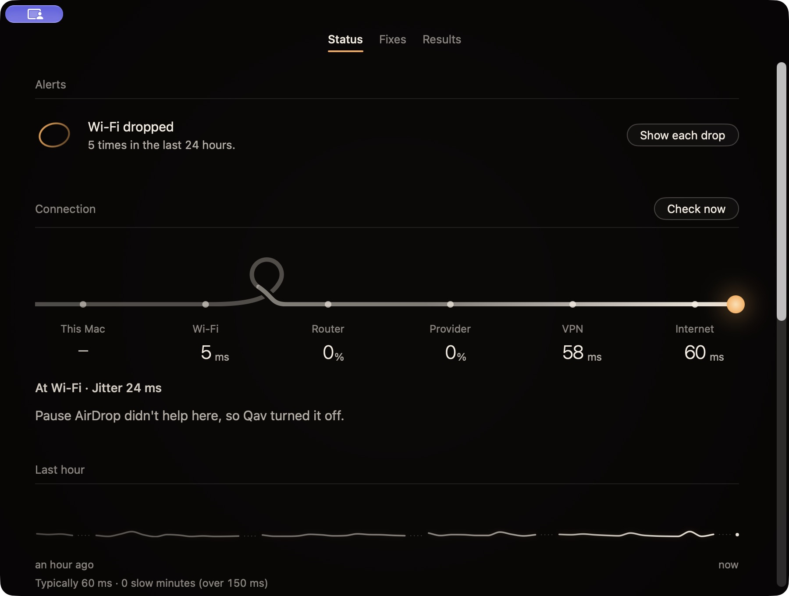

<strong>QAV</strong>

<h1 align="center">Find where your connection gets tangled.</h1>

A Mac connection companion that measures first and shows what changed.

<a href="#follow-the-line">See how it works</a> · <a href="#development-status">Development status</a>

Actual installed-app capture, 19 October 2026. These readings illustrate one connection, not a promised performance improvement.

## “The internet is slow” is only the beginning.

The problem might be close to your Mac, at the router or further along the connection. Qav makes that route visible, so a vague frustration becomes something you can investigate.

## Follow the line

**Your Mac → Wi-Fi → router → provider → VPN → internet**

**Locate.** Inspect where the connection becomes unreliable.

**Try.** Apply a relevant local adjustment.

**Compare.** Check the result and undo a change that did not help.

The screen above shows that principle in practice: an adjustment did not help, so Qav turned it off. A convincing result needs a before and an after, rather than a button that simply says “optimise.”

## Measure the line. Be honest about the rest.

I am building Qav around a practical boundary: improve what the Mac can control and explain what it cannot. It cannot create bandwidth your provider does not supply or repair a remote service.

The work combines native Mac interface design, connection diagnostics and a feedback loop in which a change has to earn its place.

## Development status

Qav is in development. This is a product preview, with a dated app capture; it is not a public download or a guarantee of faster internet. The private implementation and local connection records are not published here.

---

[More projects by Hyunjun Kim](https://github.com/EricEremos) · [Get in touch](https://www.linkedin.com/in/ericmos/)
