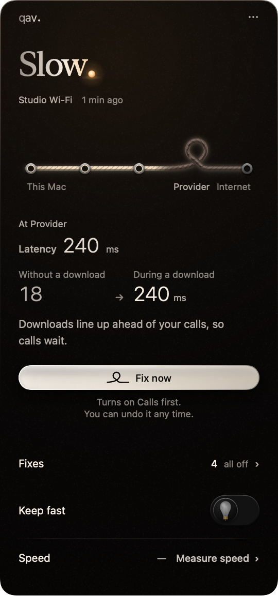
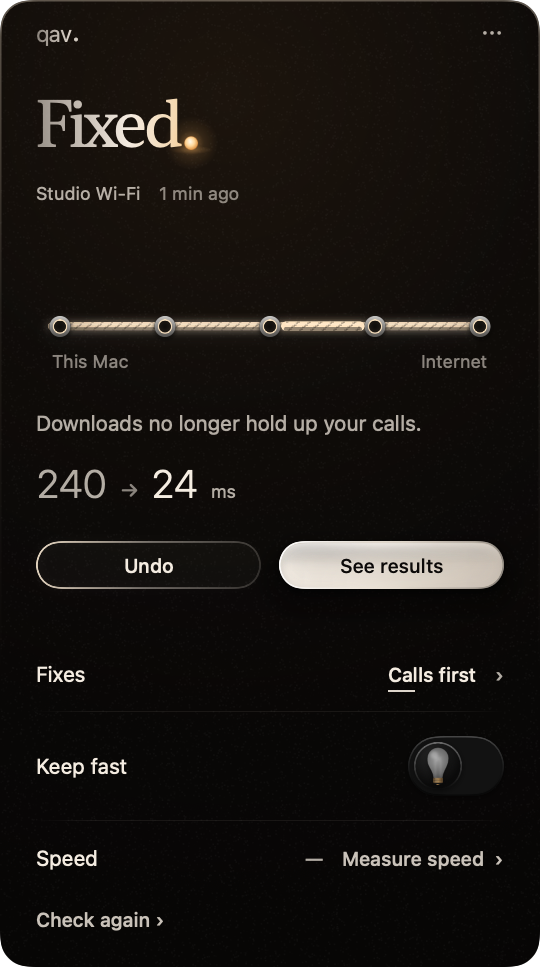
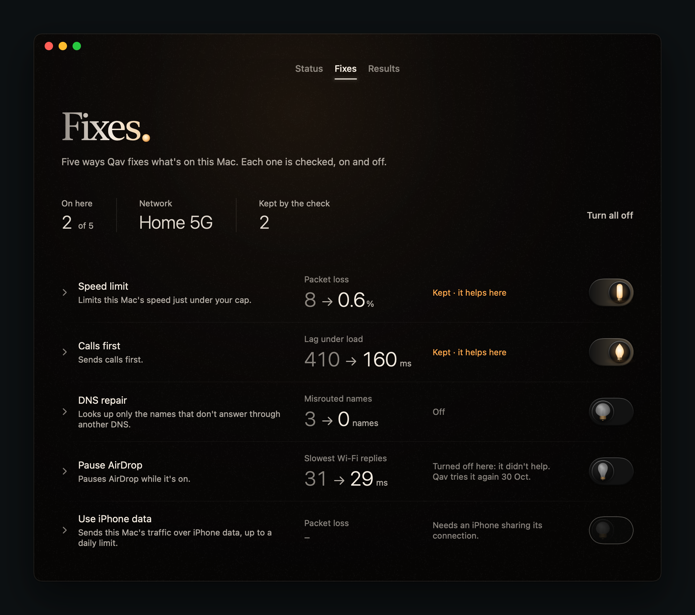

<strong>QAV</strong>

<h1 align="center">Measure the line. Straighten what's yours.</h1>

A Mac menu bar app that reads your whole connection as one line, fixes the parts this Mac can fix, and checks every fix on and off.

<a href="#one-line-from-this-mac-to-the-web">See how it works</a> · <a href="#development-status">Development status</a>

Every picture in the film is drawn by Qav itself from its newest code (10 November 2026), with the app's built-in sample data; the figures are sample readings, not a measurement of a real line. <a href="assets/qav-promo-20261114.mp4">Watch the full film</a> · <a href="assets/qav-promo-20261114-poster.png">Still frame</a> · <a href="assets/qav-promo-20261114-manifest.json">Capture details</a>

## One line, from this Mac to the web

**This Mac → Wi-Fi → router → provider → VPN → internet**

Qav reads the connection as one line and shows where it bends. A bend is a loop in shadow; a handled stretch runs straight and lit. The verdict is one word and a lamp: *Fine.* *Slow.* *Fixed.*

  
  &nbsp;&nbsp;
  

The menu bar panel before and after one fix, drawn by the app with its sample data.

## Straighten what's yours

Qav fixes only what is on this Mac, and each fix can be undone:

| Fix | What it does |
|---|---|
| **Speed limit** | Holds this Mac's traffic just under the plan's cap, so the queue stays short and on this Mac. |
| **Calls first** | Keeps the queue short and gives calls and video a small lane of their own. |
| **DNS repair** | Sends only the names your network misroutes to another resolver. |
| **Pause AirDrop** | Pauses the radio that makes Wi-Fi hop channels while it is on. |
| **Use iPhone data** | Sends this Mac's traffic over a USB iPhone, up to a daily limit. |

## Every fix is checked, on and off

**Proof** measures each fix off and on, on your Mac. A fix that does not help turns itself off, and Qav says so.

The Fixes window, drawn by the app with its sample data.

## Be honest about the rest

What Qav measures but cannot fix, such as a plan's cap or loss inside the provider's network, is listed plainly. Qav does not make a plan faster than it is; it removes what wastes the speed you already have.

## Development status

Qav is in development. A public download is not available here, and its implementation and local connection records remain private.

About the film and the screens

The film and the screens on this page were rendered on 14 November 2026 by Qav's own snapshot mode and its own line renderer, built from its newest code (10 November 2026), using the sample data the app ships for design checks. The film adds only the dark ground, its lines and the amber rings. No real connection was measured for this page.

---

[More projects by Hyunjun Kim](https://github.com/EricEremos) · [Get in touch](https://www.linkedin.com/in/ericmos/)
