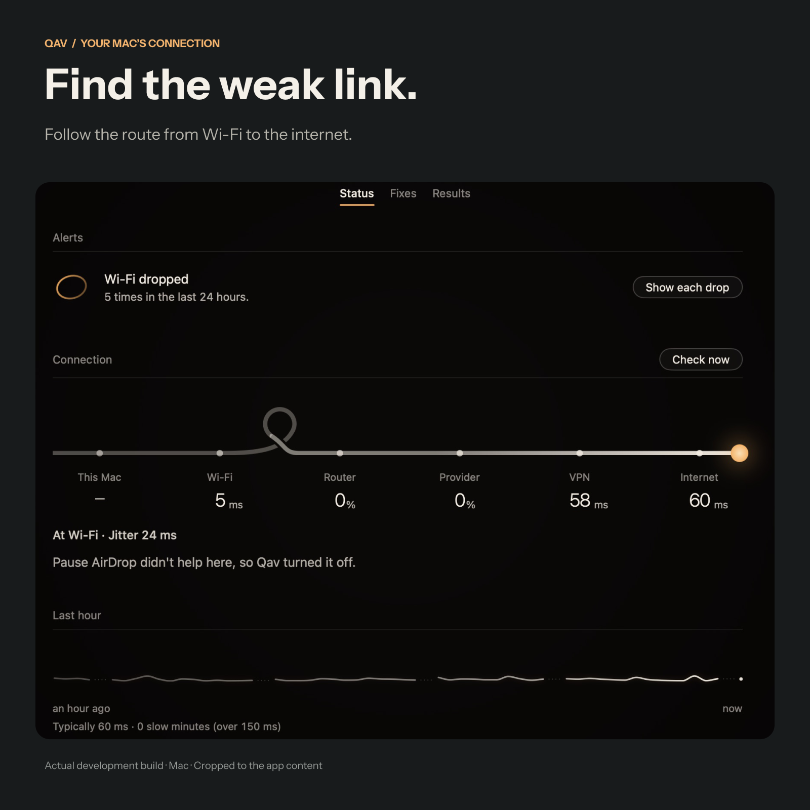

<strong>QAV</strong>

<h1 align="center">Follow the connection. See what changes.</h1>

A Mac connection companion that measures first and compares the result.

<a href="#follow-the-line">See how it works</a> · <a href="#development-status">Development status</a>

Diagnosis only. Animated product screenshot of Qav's Status screen as published in this repository; the large cord is brand animation. The captured adjustment did not help and was turned off; no fix or speed-up is promised. <a href="assets/qav-promo-20261024.mp4">Watch the full film</a> · <a href="assets/qav-promo-20261024-poster.png">Still frame</a> · <a href="assets/qav-promo-20261024-manifest.json">Capture details</a>

## “The internet is slow” is a starting point

The problem might be close to your Mac, at the router or further along the connection. Qav makes that route visible, giving you somewhere to begin investigating.

## Follow the line

**Your Mac → Wi-Fi → router → provider → VPN → internet**

**Inspect the route.** Look at the connection and where it may be struggling.

**Try a relevant change.** Apply an adjustment the Mac can control.

**Compare what happened.** Check the result and undo a change that did not help.

The capture above shows that last step: a local adjustment did not help, so Qav turned it off. The useful part is the comparison—what changed, and whether it was worth keeping.

## A change should earn its place

I am building Qav around a practical boundary: investigate what the Mac can measure, adjust what it can control and explain the rest. It cannot create bandwidth your provider does not supply or repair a remote service.

My work connects native Mac interface design, connection diagnostics and this feedback loop. Showing that a change did not help is part of the product, too.

## Development status

Qav is in development. A public download is not available here. Its implementation and local connection records remain private.

About the capture and readings

The campaign uses an actual installed-app capture from **19 October 2026**. The readings and adjustment result describe one observed connection. They are not a guarantee of faster internet or a diagnosis of another network.

---

[More projects by Hyunjun Kim](https://github.com/EricEremos) · [Get in touch](https://www.linkedin.com/in/ericmos/)
